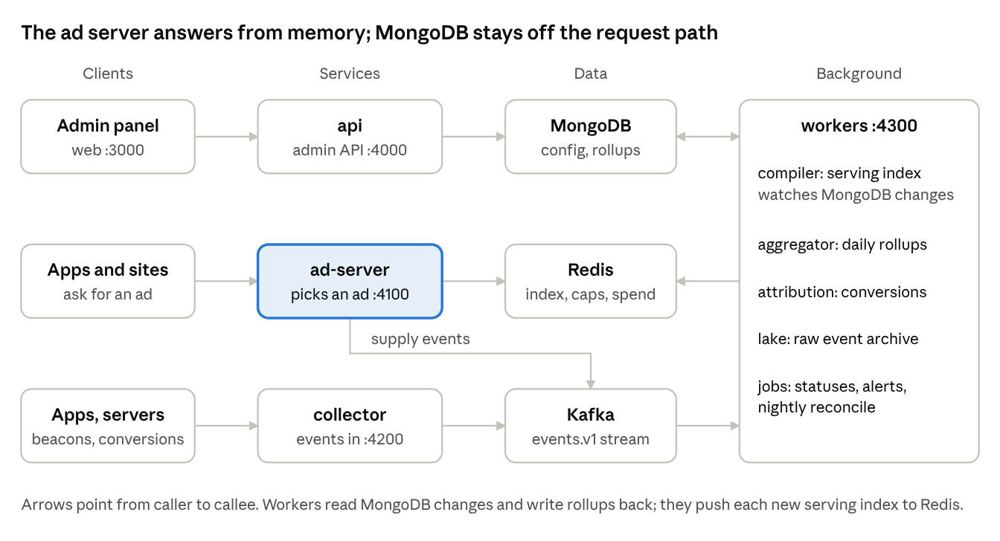

# Orbit Ads — Technical Guide

Oct 21, 2026 · Khalid · Live version: https://claude.ai/artifact/9ZVo7bsY921yZha2kcKQp7

## Overview

Orbit Ads is a first-party ad platform: five Node.js processes plus MongoDB, Redis and a Kafka-compatible stream. Admins plan campaigns in a web panel; our own apps and websites ask the ad server for an ad and report what happened back to a collector.

The five processes each have one job:

| Process | Port | Job | Talks to |
| --- | --- | --- | --- |
| `web` (Next.js) | 3000 | Admin panel in the browser | `api` only |
| `api` (Express) | 4000 | Admin REST API, sign-in, roles, uploads, analytics queries | MongoDB, Redis, `ad-server` (test requests) |
| `ad-server` (Express) | 4100 | Answers `/v1/serve`: picks one ad in about 1 ms | Redis (serving index, caps, pacing), Kafka (supply events) |
| `collector` (Express) | 4200 | Receives impressions, clicks, conversions, heartbeats | Redis (dedupe), Kafka |
| `workers` (Node) | 4300 | Compiler, aggregator, attribution, scheduled jobs, raw-event archive | MongoDB, Redis, Kafka |

The golden rule: the ad server never reads MongoDB. Everything it needs is compiled ahead of time into a serving index in Redis and held in memory, so a slow database can never slow down an ad request.

Shared code lives in five packages: `@orbit/domain` (all business rules and the API contract), `@orbit/db` (Mongoose models, indexes, migrations, seed), `@orbit/server-kit` (Express setup, errors, metrics, env parsing), `@orbit/api-client` (typed client + TanStack Query hooks) and `@orbit/sdk-web` (the 5 KB web tag).

## Repository and stack

Everything is one pnpm + Turborepo monorepo in `project/`, TypeScript 5.9 strict, Node 22 or newer.

```
project/
├── apps/
│   ├── web/          Next.js 16 admin panel
│   ├── api/          Express 5 admin API (src/modules/<area>/router → controller → service → repo)
│   ├── ad-server/    Express 5 /v1/serve, in-memory serving index
│   ├── collector/    Express 5 beacons, clicks, conversions → Kafka
│   └── workers/      compiler, aggregator, attribution, jobs, lake
├── packages/
│   ├── domain/       Zod schemas, API contract, targeting + pacing rules, ad decision
│   ├── db/           Mongoose 9 models, 22 indexes, validators, migrations, seed
│   ├── server-kit/   createApp, route(), problem+json errors, metrics, env parsing
│   ├── api-client/   typed fetch client + TanStack Query hooks
│   └── sdk-web/      the web tag (orbit.js)
├── infra/docker/Dockerfile.service   one image recipe for the four Node services
├── docker-compose.yml                Redis, Redpanda (+ topics), MailHog for development
├── docs/                             build guideline, data model, openapi.json
└── .env / .env.example               configuration (the .env is git-ignored)
```

| Layer | Technology | Why |
| --- | --- | --- |
| Admin UI | Next.js 16, shadcn/ui, Tailwind 4, TanStack Query, TanStack Table, Zustand, Zod, Recharts | Server data only in TanStack Query; Zustand only for UI state (dialogs, unsaved-changes guard) |
| API and workers | Express 5, Zod, Mongoose 9, pino logs | Every route is registered from the shared contract, so the browser client and server can't drift apart |
| Hot path | Express 5 without Mongoose, ioredis, KafkaJS | No database on the request path; p99 15 ms at about 12,000 requests/s per process |
| Data | MongoDB 7+ (Atlas), Redis 7.4, Redpanda (Kafka API) | Operational data, fast counters, and an event stream that can be replayed |
| Shared rules | `@orbit/domain` | Targeting, validation and metric formulas are written once and used by UI, API, ad server and workers |

## How everything connects

Three flows run independently: configuration flows from the panel to the ad servers, events flow from devices to the reports, and conversions flow from your servers back to the clicks that caused them. The diagram at the end of this section shows all three.

### 1. Configuration: from a click in the panel to live ads

1. An admin saves or publishes a campaign in `web`. The browser calls `api` with the session cookie; the API checks the role, validates the body with the shared Zod schema and writes MongoDB with a revision guard (`rev`), so two people can't overwrite each other.
2. The `workers` **compiler** watches MongoDB change streams on campaigns, creatives, placements, properties, keys, countries and settings. Changes are debounced for 2 s (`COMPILE_DEBOUNCE_MS`); it also recompiles every 60 s (`COMPILE_INTERVAL_MS`) so schedules start and stop on time.
3. It compiles one **serving index**: per placement, the eligible campaigns with final countries, schedule, devices, caps, pacing and ready creatives. It writes `serving:index:<version>` to Redis, points `serving:current` at it and publishes `serving:updated`.
4. Every `ad-server` process subscribes to `serving:updated`, loads the new version into memory and swaps it atomically. Publish-to-live is a few seconds.

### 2. Delivery: an ad request and what happens after

1. An app (SDK) or website (web tag `orbit.js`) calls `POST /v1/serve` on the ad server with a placement id. Apps authenticate with `x-orbit-app` + `x-orbit-key` (the key is hashed with `KEY_PEPPER` and compared with the index); websites are authenticated by their `Origin` domain.
2. The ad server finds the country (GeoIP, or `DEV_DEFAULT_COUNTRY` in development), filters candidates in memory, checks frequency caps (`fc:…`) and budget pacing (`spend:…`) in Redis, then picks the highest-priority campaign by weight and one of its creatives.
3. The response holds the creative plus tracking URLs signed with HMAC (`TRACKING_SECRETS`, key id `TRACKING_ACTIVE_KID`). A `supply` event (filled or no-fill, with the reason) goes to Kafka.
4. The device sends impression, viewable, video and reward beacons to the collector (`POST /v1/e`, or pixel `GET /t/:type/:token`); a click goes through `GET /c/:token`, which records it and redirects to the destination.
5. The **collector** verifies each signature, drops replays with a Redis key `dd:<type>:<requestId>`, and writes the event to topic `events.v1` (partitioned by campaign). Bad messages go to `events.dlq.v1`.
6. The **aggregator** worker consumes `events.v1` in batches and upserts `delivery_daily` and `supply_daily` rollups. It stores the Kafka offset in `rollup_offsets` in the same MongoDB transaction, so a crash and restart never counts an event twice. It also updates `campaign_stats` and Redis spend counters used for pacing.
7. The **lake** worker writes every raw event to compressed files (local folder or S3) for audits and re-processing.
8. Dashboards in `web` call `api` analytics endpoints, which read only the rollups through a second MongoDB connection (`MONGODB_ANALYTICS_READ_PREF`, default secondaryPreferred), so heavy reports never slow down admin writes.

### 3. Conversions: linking an install or purchase to a click

1. Each click gets a `clk_…` id, stored in `clicks` and passed to the destination (deep link or URL).
2. Your app or server later posts `POST /v1/conversions` to the collector with that click id and an event key (for example `app_install`), optionally with a value.
3. The **attribution** worker looks up the click, copies its campaign, creative, property and country onto the conversion, saves it in `conversions` and adds it to the rollups.

### Scheduled jobs (workers)

Each job takes a Redis lock (`jobs:lock:<name>`) so it runs once even with several worker replicas.

| When | What |
| --- | --- |
| Every minute | Campaign status changes (scheduled → active → completed), budget auto-pause, heartbeat-missing alerts, grace-key expiry, alert sync |
| Hourly | Copy SDK key last-used times from Redis to MongoDB |
| Nightly 03:00 Asia/Dhaka | Reconcile Redis counters with rollups; delete expired samples and sessions; monthly index-usage report |



Requests come in from the left. Only the workers sit between MongoDB and Redis, which is why a database hiccup never delays an ad.

## Data

MongoDB holds what people edit and the daily rollups; Redis holds what must be fast or short-lived; Kafka holds the raw event stream. Raw events are never written to MongoDB.

### MongoDB (database `MONGODB_DB`, 23 collections)

| Group | Collections | Notes |
| --- | --- | --- |
| People and access | `users`, `sessions`, `audit_log` | Sessions store only a SHA-256 of the cookie token; the audit log records dotted verbs such as `campaign.published` |
| Inventory | `properties`, `property_keys`, `placements`, `countries`, `settings` | Keys store a peppered hash, never the secret |
| Ads | `campaigns`, `campaign_revisions`, `creatives`, `creative_versions`, `audiences`, `event_definitions`, `budgets` | Every edit bumps `rev`; publishing writes a revision in a transaction |
| Rollups and stats | `delivery_daily`, `supply_daily`, `campaign_stats`, `rollup_offsets` | One document per day × dimensions; written only by the aggregator with `bulkWrite` upserts |
| Events kept for lookups | `clicks`, `conversions`, `request_samples`, `alerts` | Samples feed the Diagnostics tab (`REQUEST_SAMPLE_RATE`, 1% in production) |

Rules that keep the database healthy:

- Exactly **22 indexes**, all declared in `packages/db/src/schemas/*`; `pnpm db:drift` fails if the cluster differs. `autoIndex` and `autoCreate` are off: only `pnpm db:migrate` creates collections, `$jsonSchema` validators and indexes.
- Migration `0002_creatives_search` adds one Atlas Search index for creative search.
- `sanitizeFilter` is on, so query operators built in code are wrapped in `trusted()`; request input is always parsed by Zod first.
- IDs are prefixed ULIDs (`cmp_…`, `crv_…`), money is integer micros (1 USD = 1,000,000), times are UTC and the reporting day is Asia/Dhaka.

### Redis

| Key | Written by | Purpose |
| --- | --- | --- |
| `serving:index:<version>`, `serving:current`, channel `serving:updated` | compiler | The compiled serving index and the signal to reload it |
| `fc:<uidHash>:<campaignId>:<bucket>` | ad-server | Frequency-cap counters per user, campaign and hour/day/week |
| `spend:<campaignId>`, `spendh:<campaignId>:<hour>` | ad-server, aggregator | Spend counters for budget pacing |
| `dd:<type>:<requestId>` | collector | Deduplication of beacons and clicks |
| `hb:<propertyId>` | collector | Last SDK heartbeat |
| `idem:<userId>:<key>` | api | Idempotency keys for create/publish requests |
| `rl:<name>:…` | api | Rate-limit windows |
| `jobs:lock:<name>` | workers | One job run per period across replicas |

Redis runs with append-only persistence (`appendfsync everysec`). If it is lost, the compiler rebuilds the index within a minute and the nightly reconcile repairs spend counters from the rollups.

### Kafka (Redpanda)

| Topic | Partitions | Retention | Contents |
| --- | --- | --- | --- |
| `events.v1` | 24 | 7 days | Impressions, viewables, clicks, video, rewards, conversions, supply results, heartbeats |
| `events.dlq.v1` | 3 | default | Messages that failed validation or processing |

Consumer groups: aggregator, attribution and lake each read `events.v1` independently, so one slow consumer never blocks another.

## Security

Admins authenticate with a server-side session; apps authenticate with a hashed SDK key; every tracking URL is signed, so nobody can forge impressions or clicks.

| Area | How it works |
| --- | --- |
| Admin sign-in | Google Workspace via OpenID Connect (`OIDC_*`), only for invited users. Development uses email-only sign-in (`AUTH_DEV_LOGIN=true`), which must be `false` in production. |
| Sessions | Random token in the `orbit_sid` cookie (httpOnly, SameSite=Lax, Secure in production); only its SHA-256 is stored. Expires after 12 h idle or 7 days. |
| CSRF | SameSite cookies plus an Origin check: every write must come from `WEB_ORIGIN`. |
| Roles | Owner, Admin, Campaign manager, Analyst, Developer, Read-only. Each endpoint declares a permission in the contract (for example `campaigns.publish`); the API enforces it and the UI hides what you can't do. |
| Concurrency | Every write sends the `rev` it read; a stale `rev` returns 409 instead of overwriting someone else's change. |
| Idempotency | Create and publish calls accept an `Idempotency-Key`, so a double click or retry never creates two campaigns. |
| Rate limits | Per user per minute: 600 admin calls, 60 analytics queries, 20 sign-in attempts (`RATE_LIMIT_*`). |
| SDK keys | Secret shown once; stored as an HMAC with `KEY_PEPPER`. Rotation keeps the old key working for 24 h. Test and live keys are separate. |
| Websites | No secret in the page: the ad server accepts the request only if `Origin` matches the property's domain or a subdomain. |
| Tracking URLs | HMAC-signed with a key id; `TRACKING_SECRETS` holds several `kid:secret` pairs so you can rotate without breaking URLs already in flight. |
| User privacy | Device ids are hashed again with `UID_PEPPER` before use; no raw device id is stored. |
| Internal calls | The API's test request to the ad server uses `INTERNAL_TOKEN`; `/internal/*` routes must never be exposed publicly. |
| Uploads | Image and video files only, with safe names, served from signed URLs or a CDN. |

Generate every secret with at least 32 random characters, for example `openssl rand -hex 32`, and keep them only in the server's environment or a secrets manager.

## Configuration

Each service parses its environment with Zod at start-up and exits with a clear message if anything is missing. In development all services read the repo-root `.env`; in production pass variables through the container environment.

| Variable | Used by | Production value / meaning |
| --- | --- | --- |
| `NODE_ENV` | all | `production` (turns on Secure cookies, turns off .env loading) |
| `LOG_LEVEL` | all | `info` (api, workers) or `warn` (ad-server, collector) |
| `MONGODB_URI` | api, workers | Atlas connection string with a user limited to the Orbit database |
| `MONGODB_DB` | api, workers | Must start with `orbit`, e.g. `orbit_ads` |
| `MONGODB_ANALYTICS_READ_PREF` | api | `secondaryPreferred` (reports read from replicas) |
| `REDIS_URL` | all Node services | `redis://:<password>@redis:6379` |
| `REDIS_PREFIX` | api | Leave empty |
| `KAFKA_BROKERS` | ad-server, collector, workers | `redpanda:9092` inside Docker |
| `SESSION_SECRET` | api | 32+ random characters |
| `KEY_PEPPER` | api, ad-server, collector | 32+ random characters, identical in all three; changing it invalidates every SDK key |
| `UID_PEPPER` | ad-server | 32+ random characters |
| `TRACKING_SECRETS` | ad-server, collector | `k1:<secret>` (comma-separate pairs to rotate: `k2:<new>,k1:<old>`) |
| `TRACKING_ACTIVE_KID` | ad-server, collector | The key id used for new URLs, e.g. `k2` |
| `INTERNAL_TOKEN` | api, ad-server | 32+ random characters |
| `WEB_ORIGIN` | api | `https://ads.example.com` (CORS + CSRF) |
| `API_URL` | api | `https://api.ads.example.com` |
| `AD_SERVER_URL` | api | Internal URL of the ad server, e.g. `http://ad-server:4100` |
| `TRACKING_URL` | ad-server | Public collector URL put into tracking links, e.g. `https://t.ads.example.com` |
| `NEXT_PUBLIC_API_URL` | web (build time) | Public API URL |
| `NEXT_PUBLIC_AD_SERVER_URL` | web (build time) | Public ad server URL, shown in integration snippets |
| `NEXT_PUBLIC_DEV_LOGIN` | web (build time) | `false` in production |
| `NEXT_PUBLIC_ENV_LABEL` | web (build time) | Optional badge such as `Staging` |
| `AUTH_DEV_LOGIN` | api | `false` in production |
| `OIDC_ISSUER`, `OIDC_CLIENT_ID`, `OIDC_CLIENT_SECRET`, `OIDC_REDIRECT_URI`, `OIDC_ALLOWED_DOMAIN` | api | Google sign-in: issuer `https://accounts.google.com`, redirect `https://api.ads.example.com/v1/auth/oidc/callback`, your Workspace domain |
| `STORAGE_DRIVER` | api | `local` (files on a volume) or `s3` |
| `UPLOAD_DIR` | api | Folder for local uploads, e.g. `/data/uploads` (mount a volume) |
| `CDN_BASE_URL` | api | Public base URL of creative files, e.g. `https://api.ads.example.com/media` or a CDN |
| `S3_BUCKET_CREATIVES`, `AWS_REGION` | api | Only with `STORAGE_DRIVER=s3` |
| `RATE_LIMIT_ADMIN_PER_MIN`, `RATE_LIMIT_ANALYTICS_PER_MIN`, `RATE_LIMIT_LOGIN_PER_MIN` | api | Defaults 600 / 60 / 20 |
| `REQUEST_SAMPLE_RATE` | ad-server | `0.01` (1% of requests saved for Diagnostics) |
| `GEOIP_DB_PATH` | ad-server | Path to a MaxMind GeoLite2-Country `.mmdb` file; required in production for country targeting |
| `DEV_DEFAULT_COUNTRY` | ad-server | Country used when no GeoIP file is set (development only) |
| `SDK_MIN_VERSION` | ad-server | Oldest SDK allowed to receive ads (default `2.0.0`) |
| `SDK_WEB_DIST` | ad-server | Folder holding the built `orbit.js` (set by the Docker image) |
| `DEGRADED_PACING_FACTOR` | ad-server | Delivery slow-down while Redis is unreachable (default `0.5`) |
| `LAKE_DRIVER`, `LAKE_DIR`, `S3_BUCKET_LAKE` | workers | Where raw events are archived (`local` folder or `s3`) |
| `COMPILE_INTERVAL_MS`, `COMPILE_DEBOUNCE_MS` | workers | Defaults 60000 / 2000 |
| `API_PORT`, `AD_SERVER_PORT`, `COLLECTOR_PORT`, `WORKERS_PORT` | each service | Defaults 4000 / 4100 / 4200 / 4300 |

## Running locally

You need Node 22+, pnpm 10 and Docker. MongoDB comes from `MONGODB_URI` (the shared Atlas dev cluster); `docker compose --profile local-db up -d` starts a local replica set instead if you work offline.

```bash
pnpm install
cp .env.example .env      # set MONGODB_URI
pnpm infra:up             # Redis, Redpanda + topics, MailHog
pnpm db:migrate           # collections, validators, 22 indexes, search index
pnpm db:drift             # cluster indexes == declared indexes
pnpm db:seed              # demo workspace, 60 days of rollups
pnpm dev                  # all five apps in watch mode
```

Open `http://localhost:3000` and sign in with `arif.hossain@orbit.example` (owner). Other demo users are listed in `README.md`.

| Command | What it does |
| --- | --- |
| `pnpm typecheck` / `pnpm test` / `pnpm build` | Across the monorepo (333 tests today) |
| `pnpm --filter @orbit/workers e2e` | Serve → beacons → rollups end to end, including replay checks |
| `pnpm --filter @orbit/ad-server bench` | Decision-path benchmark |
| `pnpm --filter @orbit/workers jobs:run reconcile` | Run a scheduled job on demand |
| `pnpm --filter @orbit/api openapi` | Regenerate `docs/openapi.json` (also served at `/v1/openapi.json`) |
| `pnpm db:seed --reset` | Empty Orbit's own collections and reseed; never touches other databases |

Every service exposes `GET /healthz` (process is up), `GET /readyz` (its dependencies answer) and `GET /metrics` (Prometheus format).

## Hosting on a VPS

The simplest production setup is one Linux VPS running all five services, Redis and Redpanda in Docker Compose behind Caddy (automatic HTTPS), with MongoDB on Atlas. It handles millions of ad requests a day; the next section covers growing beyond one machine.

### What you need

| Item | Recommendation |
| --- | --- |
| VPS | Ubuntu 24.04, 4 vCPU, 8 GB RAM, 80 GB SSD (for example Hetzner CPX31, DigitalOcean 8 GB, AWS Lightsail 8 GB) |
| MongoDB | Atlas M10 or larger in the same region. A **replica set is required**: the API uses transactions and the compiler uses change streams, so a single standalone `mongod` will not work. |
| Domains | One registrable domain with four names, e.g. `ads.example.com` (panel), `api.ads.example.com`, `serve.ads.example.com` (ad server), `t.ads.example.com` (collector). Keep them under one domain so the SameSite session cookie works. |
| GeoIP | A free MaxMind account and the GeoLite2-Country `.mmdb` file (country targeting needs it) |
| Google sign-in | An OAuth client in Google Cloud Console with redirect `https://api.ads.example.com/v1/auth/oidc/callback` |

### 1. Prepare the server

```bash
# as root on the new VPS
adduser deploy && usermod -aG sudo deploy
curl -fsSL https://get.docker.com | sh && usermod -aG docker deploy
ufw allow OpenSSH && ufw allow 80 && ufw allow 443 && ufw enable
```

Point the four DNS names (A records) at the VPS IP. In Atlas, create a database user that can only read and write the Orbit database, and add the VPS IP to the network access list.

### 2. Add the web image recipe

The repo has an image recipe for the four Node services (`infra/docker/Dockerfile.service`) but not yet for the Next.js panel. Add `infra/docker/Dockerfile.web`:

```dockerfile
FROM node:22-alpine AS build
WORKDIR /repo
RUN corepack enable
COPY . .
ARG NEXT_PUBLIC_API_URL
ARG NEXT_PUBLIC_AD_SERVER_URL
ENV NEXT_PUBLIC_API_URL=$NEXT_PUBLIC_API_URL \
    NEXT_PUBLIC_AD_SERVER_URL=$NEXT_PUBLIC_AD_SERVER_URL \
    NEXT_PUBLIC_DEV_LOGIN=false
RUN pnpm install --frozen-lockfile && pnpm --filter "@orbit/web..." build

FROM node:22-alpine
ENV NODE_ENV=production
COPY --from=build /repo /repo
WORKDIR /repo/apps/web
USER node
EXPOSE 3000
CMD ["node_modules/.bin/next", "start", "--port", "3000"]
```

Also add a `.dockerignore` with `node_modules`, `**/node_modules`, `.env*`, `.data`, `**/.next` and `**/dist`, so secrets and local data never enter an image. `NEXT_PUBLIC_*` values are baked in at build time, so rebuild the web image when they change.

### 3. Production environment file

On the server, clone the repo to `/srv/orbit` and create `.env.production` (never commit it):

```bash
NODE_ENV=production
MONGODB_URI=mongodb+srv://<orbit-user>:<password>@<cluster>/?retryWrites=true&w=majority
MONGODB_DB=orbit_ads
REDIS_PASSWORD=<random>
REDIS_URL=redis://:<same random>@redis:6379
KAFKA_BROKERS=redpanda:9092
SESSION_SECRET=<openssl rand -hex 32>
KEY_PEPPER=<openssl rand -hex 32>
UID_PEPPER=<openssl rand -hex 32>
INTERNAL_TOKEN=<openssl rand -hex 32>
TRACKING_SECRETS=k1:<openssl rand -hex 32>
TRACKING_ACTIVE_KID=k1
WEB_ORIGIN=https://ads.example.com
API_URL=https://api.ads.example.com
AD_SERVER_URL=http://ad-server:4100
TRACKING_URL=https://t.ads.example.com
AUTH_DEV_LOGIN=false
OIDC_ISSUER=https://accounts.google.com
OIDC_CLIENT_ID=<from Google>
OIDC_CLIENT_SECRET=<from Google>
OIDC_REDIRECT_URI=https://api.ads.example.com/v1/auth/oidc/callback
OIDC_ALLOWED_DOMAIN=example.com
STORAGE_DRIVER=local
UPLOAD_DIR=/data/uploads
CDN_BASE_URL=https://api.ads.example.com/media
GEOIP_DB_PATH=/geoip/GeoLite2-Country.mmdb
SDK_WEB_DIST=/packages/sdk-web/dist
REQUEST_SAMPLE_RATE=0.01
LAKE_DRIVER=local
LAKE_DIR=/data/lake
```

### 4. Compose file

Save as `/srv/orbit/docker-compose.prod.yml`:

```yaml
name: orbit-prod
x-node: &node
  restart: unless-stopped
  env_file: .env.production
  depends_on: [redis, redpanda]
services:
  caddy:
    image: caddy:2.8-alpine
    restart: unless-stopped
    ports: ["80:80", "443:443"]
    volumes: ["./Caddyfile:/etc/caddy/Caddyfile:ro", "caddy_data:/data", "caddy_config:/config"]
  web:
    build:
      context: .
      dockerfile: infra/docker/Dockerfile.web
      args: { NEXT_PUBLIC_API_URL: "https://api.ads.example.com", NEXT_PUBLIC_AD_SERVER_URL: "https://serve.ads.example.com" }
    restart: unless-stopped
  api:
    <<: *node
    build: { context: ., dockerfile: infra/docker/Dockerfile.service, args: { APP: api } }
    volumes: ["uploads:/data/uploads"]
  ad-server:
    <<: *node
    build: { context: ., dockerfile: infra/docker/Dockerfile.service, args: { APP: ad-server } }
    volumes: ["./geoip:/geoip:ro"]
  collector:
    <<: *node
    build: { context: ., dockerfile: infra/docker/Dockerfile.service, args: { APP: collector } }
  workers:
    <<: *node
    build: { context: ., dockerfile: infra/docker/Dockerfile.service, args: { APP: workers } }
    volumes: ["lake:/data/lake"]
  redis:
    image: redis:7.4-alpine
    restart: unless-stopped
    command: ["redis-server", "--appendonly", "yes", "--appendfsync", "everysec", "--requirepass", "${REDIS_PASSWORD}"]
    volumes: ["redis:/data"]
  redpanda:
    image: redpandadata/redpanda:v24.3.6
    restart: unless-stopped
    command:
      - redpanda start --smp 1 --memory 1G --overprovisioned
      - --kafka-addr internal://0.0.0.0:9092 --advertise-kafka-addr internal://redpanda:9092
    volumes: ["redpanda:/var/lib/redpanda/data"]
  redpanda-init:
    image: redpandadata/redpanda:v24.3.6
    depends_on: [redpanda]
    entrypoint: ["/bin/sh", "-c"]
    command:
      - rpk topic create events.v1 -p 24 -r 1 --brokers redpanda:9092 -c retention.ms=604800000 || true;
        rpk topic create events.dlq.v1 -p 3 -r 1 --brokers redpanda:9092 || true
    restart: "no"
volumes: { caddy_data: {}, caddy_config: {}, uploads: {}, lake: {}, redis: {}, redpanda: {} }
```

Only Caddy publishes ports. Redis, Redpanda and the workers are reachable only inside the Docker network.

### 5. Reverse proxy and HTTPS

Save as `/srv/orbit/Caddyfile`. Caddy fetches and renews Let's Encrypt certificates on its own.

```
ads.example.com {
  reverse_proxy web:3000
}
api.ads.example.com {
  @private path /metrics /internal/*
  respond @private 404
  reverse_proxy api:4000
}
serve.ads.example.com {
  @private path /metrics /internal/*
  respond @private 404
  reverse_proxy ad-server:4100
}
t.ads.example.com {
  @private path /metrics
  respond @private 404
  reverse_proxy collector:4200
}
```

The services trust exactly one proxy hop for the client IP (`trust proxy 1`). If you also put Cloudflare in front, raise that to 2, otherwise GeoIP and rate limits see Cloudflare's IP instead of the visitor's.

### 6. First deploy

1. Download `GeoLite2-Country.mmdb` into `/srv/orbit/geoip/`.
2. Build the images: `docker compose -f docker-compose.prod.yml --env-file .env.production build`.
3. Create collections, validators and indexes from any machine with the repo: `MONGODB_URI=<prod> MONGODB_DB=orbit_ads pnpm db:migrate`, then `pnpm db:drift` must report 22 matching indexes.
4. Load the country list, default settings and the first Owner account. **There is no production setup command yet**: `pnpm db:seed` loads the full demo workspace with fake users, so it should not be used on production. A small `db:bootstrap` script needs to be added before go-live.
5. Let the containers write their volumes: `docker compose -f docker-compose.prod.yml run --rm --user root api chown -R node:node /data/uploads`, and the same for `workers` with `/data/lake`.
6. Start everything: `docker compose -f docker-compose.prod.yml --env-file .env.production up -d`.
7. Check `https://api.ads.example.com/readyz`, `https://serve.ads.example.com/readyz` and `https://t.ads.example.com/readyz` return 200, then sign in at `https://ads.example.com` with Google.
8. Register an app or website, create an SDK key and send a test request from its Integration tab.

### 7. Updating

```bash
cd /srv/orbit && git pull
docker compose -f docker-compose.prod.yml --env-file .env.production build
pnpm db:migrate        # only when a release adds a migration
docker compose -f docker-compose.prod.yml --env-file .env.production up -d
```

Each container restarts in a few seconds. During that window apps get no ad (they treat it as no-fill) and the web tag queues beacons and retries with back-off, so nothing is lost; for zero-downtime releases run two ad-server and collector replicas behind Caddy.

### 8. Backups and monitoring

| What | How |
| --- | --- |
| MongoDB | Atlas continuous backup (point-in-time restore); test a restore once a quarter |
| Uploaded creatives | Back up the `uploads` volume nightly (for example `restic` to object storage), or switch to `STORAGE_DRIVER=s3` |
| Raw event archive | Ship the `lake` volume to object storage, or use `LAKE_DRIVER=s3` |
| Redis, Redpanda | No backup needed: the index is rebuilt and counters are reconciled from MongoDB |
| Uptime | Ping the three `/readyz` URLs every minute (UptimeRobot, Better Stack, or similar) |
| Metrics | Scrape `/metrics` from inside the Docker network with Prometheus + Grafana, or the Grafana Cloud agent |
| Logs | JSON logs on stdout: `docker compose logs -f api`; set Docker's log rotation (`max-size: 50m`) |

## Managed hosting and scaling

If you'd rather not run servers, every piece maps to a managed service; the code doesn't change, only the environment variables.

| Piece | Managed option | Notes |
| --- | --- | --- |
| `web` | Vercel, Netlify, or any container platform | Set the `NEXT_PUBLIC_*` variables; keep it on a subdomain of the same domain as the API |
| `api`, `ad-server`, `collector`, `workers` | Render, Railway, Fly.io, Google Cloud Run, AWS ECS Fargate, DigitalOcean App Platform | Build each with `Dockerfile.service` and `APP=<name>`. `workers` must be an always-on worker (not request-scaled to zero) |
| MongoDB | MongoDB Atlas | M10+ for production; dedicated analytics node later |
| Redis | Upstash, Redis Cloud, AWS ElastiCache, DigitalOcean Managed Redis | Needs pub/sub (for `serving:updated`), so pick a plan that supports it |
| Kafka | Redpanda Cloud, Confluent Cloud, Upstash Kafka, AWS MSK | Create `events.v1` (24 partitions, 7-day retention) and `events.dlq.v1` |
| Creative files | S3, Cloudflare R2, DigitalOcean Spaces + a CDN | `STORAGE_DRIVER=s3`, `S3_BUCKET_CREATIVES`, `CDN_BASE_URL` = the CDN URL |
| Raw event archive | S3 or R2 | `LAKE_DRIVER=s3`, `S3_BUCKET_LAKE` |

### When to scale what

| Signal | Action |
| --- | --- |
| Ad server CPU above 60% or p99 latency above 50 ms | Add ad-server replicas behind the load balancer; they are stateless and each holds the index in memory |
| Collector CPU high | Add collector replicas; they are stateless |
| Kafka consumer lag growing for the aggregator | Add worker replicas (up to 24, one per partition); Kafka shares the partitions between them |
| Dashboards slow | Add an Atlas analytics node and keep `MONGODB_ANALYTICS_READ_PREF=secondaryPreferred` |
| Redis memory above 70% | Move to a larger plan; frequency-cap keys expire on their own (hour, day or week + margin) |

The one-VPS setup moves to this layout piece by piece: Atlas first (already done in the VPS setup), then managed Redis and Kafka, then the stateless services on a container platform with autoscaling on CPU.

## Operations

Most problems show up first in a property's Diagnostics tab (recent requests with their no-fill reason) or in a service's `/readyz`.

### Troubleshooting

| Symptom | Likely cause | Fix |
| --- | --- | --- |
| Every request returns no-fill `country` | No GeoIP file, so every visitor is `ZZ` | Set `GEOIP_DB_PATH` and restart the ad server |
| Published campaign doesn't serve | Compiler not running, or campaign blocked by a health issue | Check `workers` logs for "serving index published"; open the campaign's notice banner |
| 401 on every app request | Wrong key, revoked key, or `KEY_PEPPER` differs between api and ad-server | Use the same pepper everywhere; create a new key |
| Website gets 403 | Page domain doesn't match the property's domain | Fix the domain in the property's settings |
| Impressions not counted | Collector can't reach Kafka, or `TRACKING_SECRETS` differ between ad-server and collector | Check collector `/readyz`; use identical secrets |
| Numbers in reports lag | Aggregator consumer lag | Check `workers` logs and `/metrics`; add worker replicas |
| 409 "changed by someone else" | Normal: the record changed since you opened it | Reload and redo the edit |
| 429 on Analytics | 60 queries/min per user | Raise `RATE_LIMIT_ANALYTICS_PER_MIN` |
| Sign-in loops back | `WEB_ORIGIN` or the domains differ, so the cookie isn't sent | Keep panel and API on one parent domain over HTTPS |
| `db:drift` fails | Someone created or dropped an index by hand | Never `syncIndexes`; restore the declared set with `pnpm db:migrate` and an ADR for any new index |

### Rules for the database

- Never drop or rename collections, and never run `syncIndexes()`, `dropDatabase` or `drop()`.
- Schema changes go through a numbered migration in `packages/db/src/migrate.ts`; run `pnpm db:migrate` before deploying the code that needs it.
- `pnpm db:seed --reset` is for development databases only.

### Known gaps

| Gap | Impact | Next step |
| --- | --- | --- |
| No production setup command | Fresh production databases lack countries, settings and the first Owner | Add `pnpm db:bootstrap` |
| No web Dockerfile in the repo | Recipe exists only in this doc | Commit `infra/docker/Dockerfile.web` |
| Android and iOS SDKs not built | Websites use the web tag; apps must call the serve and beacon endpoints over HTTP themselves until the SDKs exist | Build the SDKs to the same contracts |
| Google sign-in untested end to end | Needs real Workspace credentials | Test on staging before go-live |
| Raw-event archive is gzipped NDJSON, not Parquet; S3 upload needs one extra package | Fine for audits, slower for big analysis | Switch the lake writer when needed |
| No delivery boost for campaigns behind goal | Pacing slows fast campaigns but doesn't speed up slow ones | Use the `weight` field the index already carries |
| Campaign list sorts only loaded rows | Column sort is client-side per page | Add server-side sort parameters |
| No Terraform / infrastructure as code | Servers are set up by hand | Add when moving to a managed platform |
