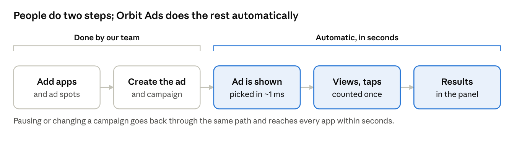

# Orbit Ads — Product Guide

Oct 21, 2026 · Khalid · Live version: https://claude.ai/artifact/1ZiDB8Ra2ZGj7LSJefNLo2

## What Orbit Ads is

Orbit Ads lets us show our own ads inside our own apps and websites, without paying an outside ad company. Think of it as a noticeboard we fully control: we decide which poster goes up, on which wall, in which country, for how long, and we can see exactly how many people looked at it and acted on it.

We use it to promote our products to the people who already use our other products. For example, someone reading match scores in one of our sports apps can see an ad for our fantasy-league app, tap it, and install it. Orbit Ads shows the ad, counts the view and the tap, and tells us whether the install happened.

Why we built it instead of using Google or Facebook ads:

- **No cost per ad.** We are advertising to our own audience, so there is no one to pay.
- **Full control.** We choose exactly where, when and to whom each ad appears.
- **Our data stays ours.** Nothing about our users is shared with an outside company.
- **One place for everything.** Every app, every website and every campaign is managed from one screen.

## Key words in plain language

You only need about ten words to use Orbit Ads. Each one has an everyday comparison.

| Word | What it means | Everyday comparison |
| --- | --- | --- |
| **App or website** (also called a *property*) | One of our own apps or sites where ads can appear | A building with walls you can put posters on |
| **Placement** | A named spot inside an app or page where an ad fits, such as "Home banner" or "Full-screen after a match" | One specific wall in that building |
| **Creative** | The ad itself: the picture or video, headline, text and button, plus where a tap takes you | The poster |
| **Campaign** | The plan that puts creatives on placements: which countries, which dates, how often, how much budget, and what goal | The booking that says which posters go on which walls, when, and for how long |
| **Format** | The kind of ad: banner, full-screen (interstitial), native (looks like normal content), video or rewarded video | The poster size and style |
| **Impression** | One time an ad was shown on someone's screen | Someone walked past the poster |
| **Click** | Someone tapped the ad | Someone stopped and read the poster closely |
| **Conversion** | Someone did the thing we wanted after tapping: installed, signed up, subscribed | Someone walked into the shop |
| **Budget** | How much a campaign may "spend". Our ads are free, but we give each one an internal value so teams share space fairly | A team's allowance |
| **Frequency cap** | The most times one person sees the same campaign, for example 3 per day | Not showing the same poster to the same person every minute |
| **Fill rate** | Out of all the times an app asked for an ad, how often we had one to show | How often a wall had a poster on it |

## How it works

An ad goes from idea to results in five steps, and only the first two need a person. Everything after you press Publish happens automatically, in seconds.

1. **Set up where ads can appear.** A developer adds each app or website once, and names the spots (placements) where ads fit.
2. **Create the ad and the campaign.** A marketer uploads the picture or video, writes the text, and builds a campaign: which apps, which countries, which dates, how often, and what goal. Then presses Publish.
3. **The ad is shown.** When someone opens one of our apps, the app quietly asks Orbit Ads "is there an ad for this spot?". Orbit Ads checks every campaign that fits (right country, right dates, not shown too often, budget left) and answers with the best one in about one thousandth of a second.
4. **Every view and tap is counted.** The app tells Orbit Ads when the ad was seen and when it was tapped. If the person later installs or buys, that is linked back to the tap. Each event is counted once, even if a phone sends it twice.
5. **You see the results.** Within minutes, the panel shows views, taps, conversions and spending by campaign, country, app and day. You can pause, change or end a campaign at any moment, and the change reaches every app within seconds.

## A tour of the screens

The menu on the left has ten screens. Every list has a search box and filters, and a ⋯ button at the end of each row with the actions for that row (view, edit, pause, duplicate, archive and so on).

| Screen | What you see | What you can do |
| --- | --- | --- |
| **Overview** | Today's headline numbers, a chart of the last weeks, and alerts that need attention (for example a campaign that can't run, or an app that stopped reporting) | Jump straight to whatever needs fixing |
| **Analytics** | Charts of views, taps, conversions and spend; a world map by country; a heat map of the best days and hours; reasons ads didn't show | Filter by campaign, country, app, device or format and compare with the previous period. Share a view by copying its link |
| **Campaigns** | Every campaign with its status, progress towards its goal and budget used | Create a campaign with a step-by-step wizard, publish, pause, resume, duplicate, archive or restore |
| **Ad creatives** | All ads as a picture grid or a table, with a live preview of how each looks on a phone or computer | Upload, edit (every change is kept as a version), submit for review, approve or reject, duplicate, archive |
| **Apps & websites** | Each app and site, whether its connection is healthy, and how many ad requests it sent this week | Add a new one, choose its ad formats and countries, get its secret key, copy the setup code, send a test ad, see recent requests |
| **Placements** | Every ad spot across all apps and how many campaigns can use it | Create, edit, pause or activate a spot |
| **Reports** | Ready-made tables: by campaign, creative, app, country, day; a funnel from view to tap to conversion | Download as a spreadsheet (CSV) |
| **Audiences** | Groups of people defined by simple rules, for example "Android users in Bangladesh" | Create or delete groups and use them in campaigns |
| **Billing & budgets** | Each team's budget for the quarter, how much is committed to campaigns and spent, and whether each campaign is on pace | Adjust a team's budget |
| **Settings** | Team members, conversion events, countries switched on or off, SDK settings, the audit log of who changed what | Invite people and set their role, turn countries on or off for everyone, add conversion events |

Safety features on every screen:

- **No accidental overwrites.** If someone else changed a campaign while you were editing it, you are told instead of silently replacing their work.
- **Unsaved-changes warning.** Leaving a half-filled form asks first.
- **Confirmation for risky actions.** Archive, pause, remove and deactivate always ask "are you sure?" and explain the effect.
- **Full history.** The audit log records every change with who made it and when.
- **Works on a phone.** Every screen adapts to a phone, tablet or computer.

## Who can do what

Everyone signs in with their company Google account, and each person has one of six roles. The panel only shows the buttons your role allows, so you can't break something by accident.

| Role | Typical person | Can do |
| --- | --- | --- |
| **Owner** | Head of the platform | Everything, including every setting and other Owners |
| **Admin** | Marketing or product lead | Everything except managing Owners; approves ads |
| **Campaign manager** | Marketer | Creates and publishes campaigns and ads |
| **Analyst** | Data or growth analyst | Sees all results and downloads reports; can't change anything else |
| **Developer** | App or web developer | Adds apps and websites, ad spots and secret keys, and checks the connection |
| **Read-only** | Anyone who just needs to look | Sees everything, changes nothing |

## Benefits

The biggest win is that promoting our own products costs nothing per ad, and we see the full picture from view to install.

| Benefit | What it means day to day |
| --- | --- |
| **Free promotion** | Our apps advertise each other with no ad fees |
| **Fast** | An ad is chosen in about 1 millisecond, so apps never feel slower; a test showed about 12,000 ad requests per second from one server |
| **Changes go live in seconds** | Pause a campaign and it stops showing almost immediately, everywhere |
| **Precise targeting** | Pick apps, countries, devices, days of the week and hours of the day per campaign |
| **Fair to users** | Frequency caps stop the same ad appearing again and again |
| **Budgets stay on track** | Spending is spread evenly over the campaign's dates, and a campaign pauses itself when its budget runs out |
| **Honest numbers** | Every view and tap is checked and counted once, even if a phone sends it twice or someone tries to fake it |
| **Reusable ads** | One ad can be used in many campaigns; edits keep a full history |
| **Quality control** | Ads can require approval before they run, with automatic checks for size, file type and missing links |
| **Private** | User data stays on our own systems; device ids are scrambled before they are stored |
| **Safe teamwork** | Roles, confirmations, no-overwrite protection and a full audit log |
| **Ready to grow** | Each part can be copied to more servers as traffic grows, without redesigning anything |

## Everyday tasks

Most work is one of four tasks. Each takes a few minutes.

### Launch a campaign

1. Make sure the ad exists: **Ad creatives → New creative**. Upload the image or video, write the headline and button text, add the link a tap should open, then **Submit for review** (an Admin approves it).
2. Go to **Campaigns → New campaign** and follow the steps: name and goal, which apps or websites, which countries for each, which ad spots and creatives, dates and hours, how often one person may see it, and the budget.
3. The last step, **Review**, lists anything blocking the launch (for example "this ad's size doesn't fit that spot") and anything worth a second look.
4. Press **Publish**. The campaign starts on its start date; ads appear in the apps within seconds of that.

### Check how a campaign is doing

1. Open **Campaigns** and look at the *Delivery vs goal* and *Budget* bars.
2. Click the campaign for its summary, or use the ⋯ menu → **Analytics** for charts by day, country and app.
3. A red **Needs attention** badge means something stops it from running fully; the campaign page explains what and how to fix it.

### Pause or stop something

- **One campaign:** ⋯ menu → **Pause**. Resume the same way.
- **One ad spot:** **Placements** → ⋯ → **Pause placement**.
- **A whole app or website:** **Apps & websites** → ⋯ → **Pause**.
- **A country, everywhere:** **Settings → Countries** → switch it off.
- **Finished for good:** ⋯ → **Archive**. Archived items keep their history and can be restored.

### Get a report for someone

1. Open **Reports**, pick the dates and the breakdown (by campaign, country, app, day…).
2. Press **Export CSV** and open the file in Excel or Google Sheets.
3. Or open **Analytics**, set the filters and copy the page link: anyone with access sees the same view.

## Limits today and common questions

The platform works end to end on websites today; a few pieces are still to come before it runs everywhere.

| Not ready yet | What it means for you |
| --- | --- |
| Ready-made Android and iOS kits (SDKs) | Websites can show ads now. Apps need these kits, or extra work by their developers, before they can show ads |
| Google sign-in tested on the live system | It is built, but must be tested with our real company accounts before launch |
| Extra push for campaigns behind their goal | Campaigns that are ahead are slowed down, but campaigns that are behind are not yet sped up |
| Live hosting | It runs on a development computer today; the technical guide explains how to put it on a server |

### Questions people ask

**Does Orbit Ads cost money per ad?** No. It shows our ads in our own apps. The "budget" is an internal number so teams share space fairly.

**How fast do changes take effect?** Within a few seconds of pressing Publish, Pause or Archive.

**How quickly do results appear?** Within a few minutes; reports are grouped by day in Bangladesh time.

**Why didn't my ad show?** Open the campaign: a notice explains the reason, such as an ad that isn't approved, a country switched off, or a size that doesn't fit the spot. Developers can also see the exact reason for each recent request in the app's Diagnostics tab.

**Can one ad be used in several campaigns?** Yes. Ads are reusable; editing one keeps the old versions.

**What happens if I archive something by mistake?** Use the ⋯ menu → Restore. Nothing is permanently deleted, and all its history stays.

**Is user data shared with anyone?** No. Everything stays on our own systems, and phone identifiers are scrambled before they are stored.

**Who do I ask for access?** An Owner or Admin invites you under Settings → Team and picks your role.
